# 🌐 Awesome Global Geolocation & Proxy Testing

  

  
  
  
  
  
  

---

## 📌 Top Global Geolocation & Proxy Testing Ecosystem

**A Curated List of Enterprise SaaS Platforms & Open-Source Tools for Web Scraping, Geo-Targeted Proxies, IP Rotation & Self-Hosted Proxy Pools**  
*Focused on residential proxies, mobile proxies, datacenter IPs, reverse proxy rotation, anti-bot bypass & geolocation verification.*  
📅 **Last updated: March 2026**

This repository serves as a comprehensive developer and QA guide to **Global Geolocation & Proxy Testing**. Modern web applications, ad networks, anti-fraud algorithms, and AI scraping pipelines heavily depend on geo-distributed IP infrastructure. Here you will find direct comparisons of market leaders (Bright Data, Oxylabs, Decodo, NetNut, ScraperAPI) along with high-performance open-source rotators (such as Rota, mubeng, proxy_pool) to manage cost predictability and achieve complete data sovereignty.

---

## 📑 Table of Contents
- [📊 Sector Overview & Market Dynamics](#-sector-overview--market-dynamics)
- [🏢 SaaS/Hosted Platforms](#-saashosted-platforms)
- [🔓 Open-Source GitHub Projects](#-open-source-github-projects)
- [🤝 How to Contribute](#-how-to-contribute)
- [💖 Support](#-support)
- [⚠️ Disclaimer](#-disclaimer)
- [⭐ Star History](#-star-history)

---

## 📊 Sector Overview & Market Dynamics

The global proxy networks and automated web data extraction market is estimated at approximately **$1.5B to $2.3B annually**, growing at a 14%–18% CAGR fueled by surging demand for AI model pre-training datasets and geolocation-aware scraping. The sector exhibits a **barbell market structure with moderate-to-high fragmentation**: while enterprise infrastructure is heavily concentrated among a few well-capitalized giants (notably Oxylabs and Bright Data, which capture significant enterprise spend), the remainder of the landscape remains highly fragmented with a long tail of niche residential providers, API wrappers, and regional resellers competing aggressively on price.

---

## 🏢 SaaS/Hosted Platforms

| Product | Company Scale (Revenue / Valuation) | Description | Pricing (Starting) | Free Tier / Trial Limits |
|---------|-------------------------------------|-------------|-------------------|--------------------------|
| **[Oxylabs](https://oxylabs.io/)** | **$3.6B Valuation** / ~$350M+ ARR | **Enterprise-grade residential proxies with explicit geo-targeting.** Starter package: 5GB at $6/GB ($30/month). Supports country, state, city, and ZIP targeting [citation:3]. | Starter: **$30/month** (5GB at $6/GB); volume discounts down to $2.50/GB at 1TB [citation:3] | **7-day free trial** for registered businesses (requires business email validation) [citation:14] |
| **[Bright Data](https://brightdata.com/)** | **~$1B+ Valuation** / ~$300M+ ARR | **The largest residential proxy network (400M+ IPs across 195 countries).** Rotating residential proxies with enterprise-grade performance. **Residential proxies require KYC verification**—no automatic path [citation:2]. | Residential from **$2.94/GB** (promotional pay-as-you-go); standard pay-as-you-go ~$8/GB; Micro plan at **$10/month** [citation:2][citation:13] | **$5 free trial credits** for new accounts; residential proxy trial requires manual KYC verification [citation:13] |
| **[NetNut](https://netnut.io/)** | **~$40.7M+ Annual Revenue** (Alarum Technologies, NASDAQ: ALAR) | **Carrier-direct residential proxies with city-level targeting.** Pay-per-traffic pricing with volume discounts. Starter 28GB at $3.53/GB . | Starter plan at **$99/month** (28GB at $3.53/GB); rotating datacenter proxies from **$20/month** (20GB) | **7-day free trial** available for qualified business accounts (requires business verification) |
| **[Decodo (Smartproxy)](https://decodo.com/)** | **~$1M–$11M ARR** (Est.) | **Rebranded from Smartproxy in 2025.** 115M+ residential IPs across 195+ locations with continent, country, state, city, ZIP, and ASN targeting. Bandwidth-based monthly or pay-as-you-go [citation:4][citation:15]. | Pay-as-you-go at **$3.75/GB** (3GB minimum = $11.25); monthly subscriptions from **$28/month** (8GB at $3.50/GB) [citation:4][citation:15] | **3-day free trial** (capped at 100MB bandwidth); **14-day money-back guarantee** (void once trial bandwidth is utilized) [citation:15] |
| **[IPRoyal](https://iproyal.com/)** | **~$5M–$10M Revenue** (Est., 50%+ YoY surge) | Consumer-level proxy service with 32M+ residential IPs. Accepts 25+ cryptocurrencies. **Residential starts at $7.99 first GB, then $5.15/GB up to 50GB** [citation:6]. | Dedicated datacenter proxies from **$1.39/proxy/month**; rotating residential pay-as-you-go from **$7.00/GB** (traffic never expires) [citation:6] | **No free tier or trial available**; test access requires purchasing a 1-proxy or 1-GB entry tier [citation:6] |
| **[ScraperAPI](https://www.scraperapi.com/)** | **~$3M–$5M ARR** (Acquired by SaaS.group) | **API-based scraping with built-in proxy rotation and geo-targeting.** Global country-level targeting on Business+ plans; US/EU only on Hobby/Startup. Credit-based billing (1 credit standard page, 5 Amazon, 25 Google, +10 bypass surcharge) [citation:10]. | Hobby plan at **$49/month** (100,000 API credits, 20 concurrent threads); Business at **$299/month** (3M credits, global geo) [citation:10] | **Free forever plan**: 1,000 credits/month (5 concurrent threads); **7-day free trial** with 5,000 credits (no credit card required) [citation:10] |
| **[Webshare](https://webshare.io/)** | **~$3M–$5M Annual Revenue** (Est.) | **Best free option.** **10 free datacenter proxies + 1 GB/month forever**—never expire. Residential pool of 300M+ IPs [citation:5]. | Datacenter proxies from **$2.99/month** (100 proxies); rotating residential from **$3.50/month** (1GB bandwidth) | **Free forever plan**: 10 shared datacenter proxies with 1 GB/month bandwidth, no credit card required [citation:5] |
| **[Rayobyte](https://rayobyte.com/)** | **~$1M–$3M Annual Revenue** (7-figure bootstrapped) | Rotating, shared, and dedicated datacenter proxies. Rotating proxies support US geo-targeting with 10–120 minute rotation intervals. Dedicated proxies support SOCKS [citation:9]. | Semi-dedicated datacenter proxies from **$1.00/proxy/month** (minimum 5 proxies = $5/month); residential pay-as-you-go from **$3.50/GB** [citation:9] | **Free Scraping API plan**: 5,000 free requests forever; **2-day money-back guarantee** on 5-proxy starter datacenter packages [citation:9] |

---

## 🔓 Open-Source GitHub Projects

| Project | Star Badge | Description |
|---------|------------|-------------|
| **[proxy_pool](https://github.com/jhao104/proxy_pool)** |  | **Python proxy pool for spiders and crawlers.** Features automated proxy harvesting from free proxy providers, Redis-backed storage, active health-checking and score tracking, and a RESTful API to easily retrieve usable proxies on demand. |
| **[ProxyPool](https://github.com/Python3WebSpider/ProxyPool)** |  | **Efficient, modular proxy pool with Getter, Tester, and Server architecture.** Built in Python with Redis and a built-in Flask API. Employs async health-checking to maintain high availability across fetched IP pools. |
| **[haipproxy](https://github.com/SpiderClub/haipproxy)** |  | **High-availability distributed IP proxy pool powered by Scrapy and Redis.** Specifically designed for high-concurrency enterprise web spiders with targeted crawler validation, multi-rule testing, and automatic failover. |
| **[scylla](https://github.com/MikeChongCan/scylla)** |  | **Intelligent proxy pool and IP rotation engine for web scraping and AI pipelines.** Features automatic proxy scraping from dozens of sources, continuous validation of anonymity level and geolocation, a JSON API, and a web management interface. |
| **[mubeng](https://github.com/mubeng/mubeng)** |  | **Incredibly fast proxy checker and IP rotator written in Go.** Operates both as a high-speed IP validator and as a local rotating proxy server (acting as an upstream aggregator across entire proxy lists) with minimal memory footprint. |
| **[requests-ip-rotator](https://github.com/Ge0rg3/requests-ip-rotator)** |  | **Python library leveraging AWS API Gateway's massive IP pools to generate pseudo-infinite rotating exit IPs.** Transparently creates and destroys API Gateway HTTP proxies across all AWS regions to bypass IP rate limits without managing servers. |
| **[rotating-proxy](https://github.com/mattes/rotating-proxy)** |  | **Rotating TOR proxy in Docker with HAProxy load balancing.** Spins up multiple Tor circuit instances concurrently in isolated containers and rotates client exit nodes through a unified local SOCKS/HTTP port. |
| **[Rota](https://github.com/alpkeskin/rota)** |  | **High-performance self-hosted proxy rotation engine in Go.** Handles thousands of requests per second with four rotation strategies (random, round-robin, least-conn, time-based), live config watching, automatic health checking, and Docker support [citation:11]. |

💡 **Frameworks for building custom systems**: Combine open-source rotators like **Rota** or **mubeng** over free upstream proxies or **Webshare's free datacenter proxies** for a zero-cost testing setup—avoiding per-GB residential proxy fees when evaluating geo-targeted services.

---

## 🤝 How to Contribute

1. 🍴 Fork the repo.
2. 📝 Add or edit entries in `README.md` following the established table structure.
3. 🔗 Include: name, official link, specific pricing starting tier, verified trial/free limits, company scale, and star badges.
4. 🚀 Submit a PR with a concise description of your update.

---

## 💖 Support

If you find this curated directory useful for your geolocation testing, web crawling, or proxy infrastructure:

- ⭐ **Star this repository** to help others discover it.
- 🍴 **Fork and contribute** updates, newly discovered tools, or pricing changes.
- 📢 **Share with colleagues** and teams working on geolocation and proxy engineering.
- ☕ **Support the maintainer**: If you'd like to sponsor the project or buy a coffee, visit the [GitHub Sponsors Dashboard](https://github.com/sponsors/ishandutta2007).

---

## ⚠️ Disclaimer

- This is a **community-curated** list — not exhaustive and not an endorsement.
- Proxy testing tools route traffic through third-party IPs; **respect target site terms of service**, avoid scraping personal data, and ensure your use case complies with applicable laws. **Bright Data requires KYC for residential proxies**—no automatic path [citation:2].
- **Residential proxy pricing is per-GB and can compound quickly, with advertised rates often hiding entry-level reality.** **Decodo's "$2/GB" headline only applies to the 1TB Enterprise tier**—the cheapest clickable rate is $3.75/GB, an 88% gap between banner and reality [citation:15]. **Bright Data starts at ~$8/GB** at entry, dropping to ~$3.30/GB only at 10TB scale [citation:13]. **Oxylabs Starter is $6/GB** with volume discounts down to $2.50/GB at 1TB [citation:3]. **IPRoyal has no free trial and charges for small changes like proxy renames** [citation:6]. **Webshare offers a genuine free tier** (10 datacenter proxies, 1 GB/month) for learning and light testing [citation:5]. **ScraperAPI's credit system means a single Amazon page costs 5 credits and a Cloudflare-protected page costs 11**—model your actual target mix before committing [citation:10]. **Validate whether you need commercial residential IPs (Bright Data, Oxylabs), a free tier for light testing (Webshare), or self-hosted rotation over your own proxy sources (Rota)** before committing.

---

## ⭐ Star History

