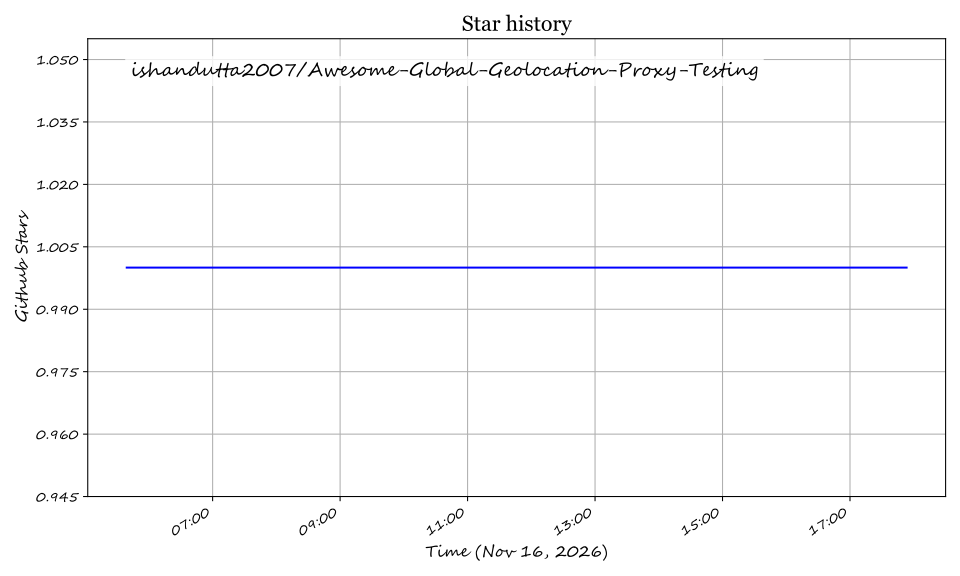

# Awesome-Global-Geolocation-Proxy-Testing
# Awesome-Global-Geolocation-Proxy-Testing

## Top Global Geolocation & Proxy Testing Ecosystem

**Curated List of SaaS Platforms & Open-Source GitHub Projects**  
*Focused on Geo-Targeted Proxies, IP Rotation & Self-Hosted Proxy Pools*  
**Last updated: March 2026**

This repository tracks notable **SaaS platforms** and **open-source projects** for **Global Geolocation & Proxy Testing**. These tools help teams simulate traffic from different countries and cities—covering everything from commercial residential proxy networks with hundreds of millions of IPs to open-source proxy rotators and self-hosted agent pools that give you full control over your exit IPs without per-GB fees.

**Examples** include Bright Data, Oxylabs, Decodo (formerly Smartproxy), Webshare, IPRoyal, NetNut, ScraperAPI, and open-source alternatives like Rota (the category leaders).

**Open-source emphasis**: This section highlights every major active project for self-hosted proxy rotation, open-source agent pools, and community-driven geolocation testing—ideal for teams seeking data sovereignty and avoiding per-GB residential proxy pricing that compounds with test volume. The open-source landscape is genuinely functional: **Rota** provides a high-performance self-hosted proxy rotator with health checks, multiple rotation strategies, and Docker deployment [citation:11].

Contributions welcome! Open an PR to add/update entries. Keep descriptions factual and link to official sites.

## Table of Contents
- [Sector Overview & Market Dynamics](#sector-overview--market-dynamics)
- [SaaS/Hosted Platforms](#saas-hosted-platforms)
- [Open-Source GitHub Projects](#open-source-github-projects)
- [How to Contribute](#how-to-contribute)
- [Disclaimer](#disclaimer)

## Sector Overview & Market Dynamics

The global proxy networks and automated web data extraction market is estimated at approximately **$1.5B to $2.3B annually**, growing at a 14%–18% CAGR fueled by surging demand for AI model pre-training datasets and geolocation-aware scraping. The sector exhibits a **barbell market structure with moderate-to-high fragmentation**: while enterprise infrastructure is heavily concentrated among a few well-capitalized giants (notably Oxylabs and Bright Data, which capture significant enterprise spend), the remainder of the landscape remains highly fragmented with a long tail of niche residential providers, API wrappers, and regional resellers competing aggressively on price.

## SaaS/Hosted Platforms

| Product | Company Scale (Revenue / Valuation) | Description | Pricing (Starting) | Free Tier / Trial Limits |
|---------|-------------------------------------|-------------|-------------------|--------------------------|
| **[Oxylabs](https://oxylabs.io/)** | **$3.6B Valuation** / ~$350M+ ARR | **Enterprise-grade residential proxies with explicit geo-targeting.** Starter package: 5GB at $6/GB ($30/month). Supports country, state, city, and ZIP targeting [citation:3]. | Starter: **$30/month** (5GB at $6/GB); volume discounts down to $2.50/GB at 1TB [citation:3] | **7-day free trial** for registered businesses (requires business email validation) [citation:14] |
| **[Bright Data](https://brightdata.com/)** | **~$1B+ Valuation** / ~$300M+ ARR | **The largest residential proxy network (400M+ IPs across 195 countries).** Rotating residential proxies with enterprise-grade performance. **Residential proxies require KYC verification**—no automatic path [citation:2]. | Residential from **$2.94/GB** (promotional pay-as-you-go); standard pay-as-you-go ~$8/GB; Micro plan at **$10/month** [citation:2][citation:13] | **$5 free trial credits** for new accounts; residential proxy trial requires manual KYC verification [citation:13] |
| **[NetNut](https://netnut.io/)** | **~$40.7M+ Annual Revenue** (Alarum Technologies, NASDAQ: ALAR) | **Carrier-direct residential proxies with city-level targeting.** Pay-per-traffic pricing with volume discounts. Starter 28GB at $3.53/GB . | Starter plan at **$99/month** (28GB at $3.53/GB); rotating datacenter proxies from **$20/month** (20GB) | **7-day free trial** available for qualified business accounts (requires business verification) |
| **[Decodo (Smartproxy)](https://decodo.com/)** | **~$1M–$11M ARR** (Est.) | **Rebranded from Smartproxy in 2025.** 115M+ residential IPs across 195+ locations with continent, country, state, city, ZIP, and ASN targeting. Bandwidth-based monthly or pay-as-you-go [citation:4][citation:15]. | Pay-as-you-go at **$3.75/GB** (3GB minimum = $11.25); monthly subscriptions from **$28/month** (8GB at $3.50/GB) [citation:4][citation:15] | **3-day free trial** (capped at 100MB bandwidth); **14-day money-back guarantee** (void once trial bandwidth is utilized) [citation:15] |
| **[IPRoyal](https://iproyal.com/)** | **~$5M–$10M Revenue** (Est., 50%+ YoY surge) | Consumer-level proxy service with 32M+ residential IPs. Accepts 25+ cryptocurrencies. **Residential starts at $7.99 first GB, then $5.15/GB up to 50GB** [citation:6]. | Dedicated datacenter proxies from **$1.39/proxy/month**; rotating residential pay-as-you-go from **$7.00/GB** (traffic never expires) [citation:6] | **No free tier or trial available**; test access requires purchasing a 1-proxy or 1-GB entry tier [citation:6] |
| **[ScraperAPI](https://www.scraperapi.com/)** | **~$3M–$5M ARR** (Acquired by SaaS.group) | **API-based scraping with built-in proxy rotation and geo-targeting.** Global country-level targeting on Business+ plans; US/EU only on Hobby/Startup. Credit-based billing (1 credit standard page, 5 Amazon, 25 Google, +10 bypass surcharge) [citation:10]. | Hobby plan at **$49/month** (100,000 API credits, 20 concurrent threads); Business at **$299/month** (3M credits, global geo) [citation:10] | **Free forever plan**: 1,000 credits/month (5 concurrent threads); **7-day free trial** with 5,000 credits (no credit card required) [citation:10] |
| **[Webshare](https://webshare.io/)** | **~$3M–$5M Annual Revenue** (Est.) | **Best free option.** **10 free datacenter proxies + 1 GB/month forever**—never expire. Residential pool of 300M+ IPs [citation:5]. | Datacenter proxies from **$2.99/month** (100 proxies); rotating residential from **$3.50/month** (1GB bandwidth) | **Free forever plan**: 10 shared datacenter proxies with 1 GB/month bandwidth, no credit card required [citation:5] |
| **[Rayobyte](https://rayobyte.com/)** | **~$1M–$3M Annual Revenue** (7-figure bootstrapped) | Rotating, shared, and dedicated datacenter proxies. Rotating proxies support US geo-targeting with 10–120 minute rotation intervals. Dedicated proxies support SOCKS [citation:9]. | Semi-dedicated datacenter proxies from **$1.00/proxy/month** (minimum 5 proxies = $5/month); residential pay-as-you-go from **$3.50/GB** [citation:9] | **Free Scraping API plan**: 5,000 free requests forever; **2-day money-back guarantee** on 5-proxy starter datacenter packages [citation:9] |

## Open-Source GitHub Projects

| Project | Star Badge | Description |
|---------|------------|-------------|
| **[Rota](https://github.com/alpkeskin/rota)** |  | **The most mature self-hosted proxy rotator for high-throughput testing.** **Go-based**, handles thousands of requests per second. **Four rotation methods**: random, round-robin, least-conn, and time-based. **Automatic proxy pool management**: file watching detects changes, health checker removes unhealthy proxies, `remove_unhealthy` keeps the pool clean. **HTTP and SOCKS5** support. **Rate limiting** prevents abuse. **Docker image available** (`ghcr.io/alpkeskin/rota:latest`). **API and health check endpoints** for monitoring [citation:11]. **Best for teams wanting a fast, self-hosted rotating proxy** with minimal configuration. |

### Additional Strong Open-Source Options

| Project | Star Badge | Description |
|---------|------------|-------------|
| **[Rota (Go Package)](https://pkg.go.dev/github.com/wretchedaircr/rota)** | — | **Go module implementation of Rota.** Can be imported directly into Go applications for embedded proxy rotation. Same rotation methods and health check capabilities as the standalone binary [citation:11]. **Best for Go developers** wanting proxy rotation as a library rather than a service. |

**Frameworks for building custom systems**: Choose **Rota** for a fast self-hosted rotator over an existing proxy list, or combine **Webshare's free datacenter proxies** with **Rota** for a zero-cost testing setup—all without per-GB residential proxy fees.

## How to Contribute

1. Fork the repo.
2. Add/edit entries in `README.md` (follow existing format).
3. Include: name, link, 1–2 sentence description, and whether it's SaaS or open-source.
4. Submit PR with a short explanation.

Star the repo if you find it useful!

## Disclaimer

- This is a **community-curated** list — not exhaustive and not an endorsement.
- Proxy testing tools route traffic through third-party IPs; **respect target site terms of service**, avoid scraping personal data, and ensure your use case complies with applicable laws. **Bright Data requires KYC for residential proxies**—no automatic path [citation:2].
- **Residential proxy pricing is per-GB and can compound quickly, with advertised rates often hiding entry-level reality.** **Decodo's "$2/GB" headline only applies to the 1TB Enterprise tier**—the cheapest clickable rate is $3.75/GB, an 88% gap between banner and reality [citation:15]. **Bright Data starts at ~$8/GB** at entry, dropping to ~$3.30/GB only at 10TB scale [citation:13]. **Oxylabs Starter is $6/GB** with volume discounts down to $2.50/GB at 1TB [citation:3]. **IPRoyal has no free trial and charges for small changes like proxy renames** [citation:6]. **Webshare offers a genuine free tier** (10 datacenter proxies, 1 GB/month) for learning and light testing [citation:5]. **ScraperAPI's credit system means a single Amazon page costs 5 credits and a Cloudflare-protected page costs 11**—model your actual target mix before committing [citation:10]. **Validate whether you need commercial residential IPs (Bright Data, Oxylabs), a free tier for light testing (Webshare), or self-hosted rotation over your own proxy sources (Rota)** before committing.

---

**Made for QA engineers, data collection teams, and developers building geolocation testing infrastructure.**  
Let's make global geolocation and proxy testing more open, controllable, and cost-predictable.

## ⭐ Star History

<a href="https://star-history.com/#ishandutta2007/Awesome-Global-Geolocation-Proxy-Testing&Timeline" align="center">
  <picture>
    <source media="(prefers-color-scheme: dark)" srcset="assets/ishandutta2007_Awesome-Global-Geolocation-Proxy-Testing_growth.svg">
    
  </picture>
</a>
